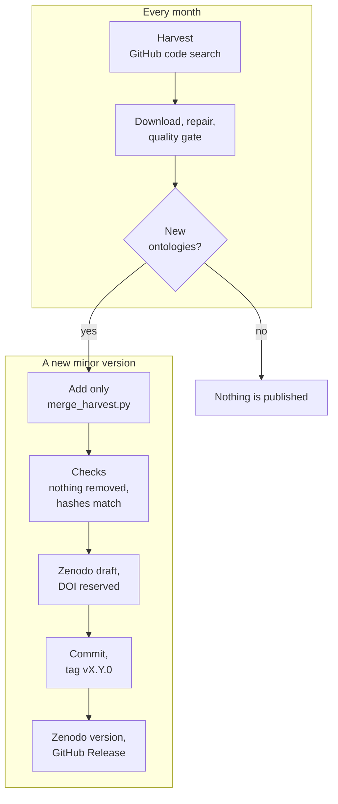

# Changelog

Every version is a git tag, a GitHub Release and a Zenodo version under the
concept DOI [10.5281/zenodo.17751740](https://doi.org/10.5281/zenodo.17751740),
which always resolves to the newest. Earlier versions stay resolvable under
their own DOIs. The newest version is **v1.2.0** (2026-08-05); 2 versions have been published.

## The dataset over time

**Corpus** counts every ontology discovered and published, whether or not it
passes the quality gate; **pass the gate** is the union of the `*-reuse` views;
**pairs** are ontology–pattern pairs summed over the three `*-reuse` views.
Versions before the gate are marked on the axis but have no comparable counts.

## What each version added

Each bar is one version's addition to the corpus: the ontologies that pass the
gate, and the ones that were added but are excluded, each with the rule that
excluded it in `MANIFEST.csv`. A version adds; it never removes, so every
earlier version's ontologies are still in the newer ones.

## Every version

| Version | Corpus | Gated | Pairs | Added | Zenodo |
|---|---:|---:|---:|---|---|
| **v1.2.0** · 2026-08-05 | 1,973 | 501 | 1,517 | baseline | [zenodo.21808321](https://doi.org/10.5281/zenodo.21808321) |
| **v1.0.0** · 2025-11-28 | — | — | — | — | [zenodo.17751741](https://doi.org/10.5281/zenodo.17751741) |

`release-iri/history.csv` holds these numbers for every version and view, and
`release-iri/additions/v<version>.csv` lists the ontologies each version added.

## Release notes

### v1.2.0 — 2026-08-05

The quality-gated release. Zenodo:
[10.5281/zenodo.21808321](https://doi.org/10.5281/zenodo.21808321).

- Every discovered ontology, **1,973**, ships unfiltered, and `MANIFEST.csv`
  records the quality gate's verdict on each (rules G1–G6); **501** pass.
- Six views over that one corpus: `*-reuse` and `*-complete` for the GitHub,
  paper/repository (noOBO) and DOS-DP (OBO) portions.
- The 1,017 zero-byte pattern files of the earlier harvest were refilled before
  gating.
- Rule G2 removes ontologies that are themselves copies of a pattern: the
  previously published complete-reuse set contained 14 such files out of 49.
- An IRI-anonymised twin of the corpus, `corpus-hashed.zip`.

### v1.0.0 — 2025-11-28

First deposit, before the quality gate: the GitHub, paper/repository and
DOS-DP datasets and the gold datasets. Zenodo:
[10.5281/zenodo.17751741](https://doi.org/10.5281/zenodo.17751741). Its counts
are not comparable with later versions.

## Versioning

| Bump | Trigger | Comparability |
|---|---|---|
| **major** | the gate changes which ontologies are kept, or a view changes definition | earlier results **not** comparable |
| **minor** | new ontologies or pairs from a harvest; gate unchanged | earlier results valid on their subset |
| **patch** | repairs, metadata, documentation; membership unchanged | fully comparable |

## How a new version is made

**The corpus grows; it never shrinks.** `harvest.yml` re-runs discovery,
repair and the gate for the GitHub portion every month, searching the release's
pattern IRIs plus any the ODPA has published since. A harvest queries live APIs
and is a partial sample, not a census: code search returns at most 1,000 files
per query, and a file a harvest does not return is usually still there. So a
harvest only adds. `merge_harvest.py` keeps every released row, file and verdict
as it is, gates the ontologies the release does not have against it (a new copy
of a released file is a duplicate of the released one), and re-verifies their
removals. `publish-release.yml` then checks that the update only adds, that the
gate is the released gate, and that every file in the new archive matches the
hash the gate recorded, and publishes the result as the next minor version:
a Zenodo version, a git tag and a GitHub Release. If any check fails, nothing
is published.

**The release reproduces.** `reproduce.yml` downloads the newest corpus
archived on Zenodo, checks every ontology file against the hash the gate
recorded, re-runs the gate and compares every row with the `MANIFEST.csv` of
the release it belongs to. It runs monthly and on every change to the gate.
